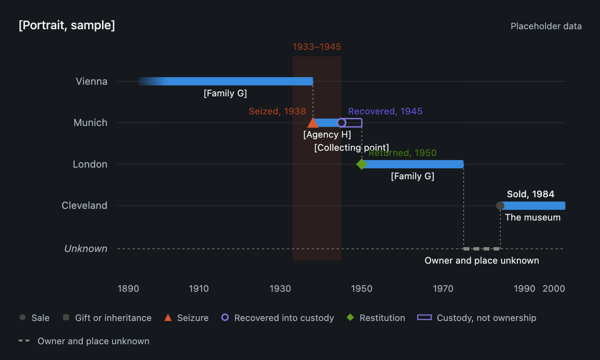
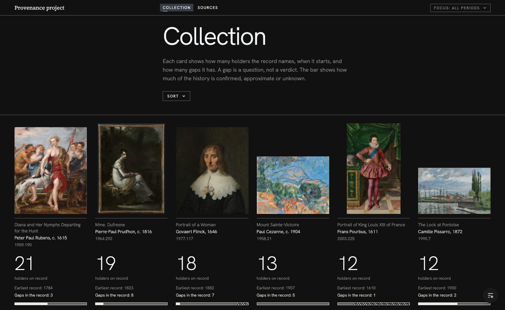
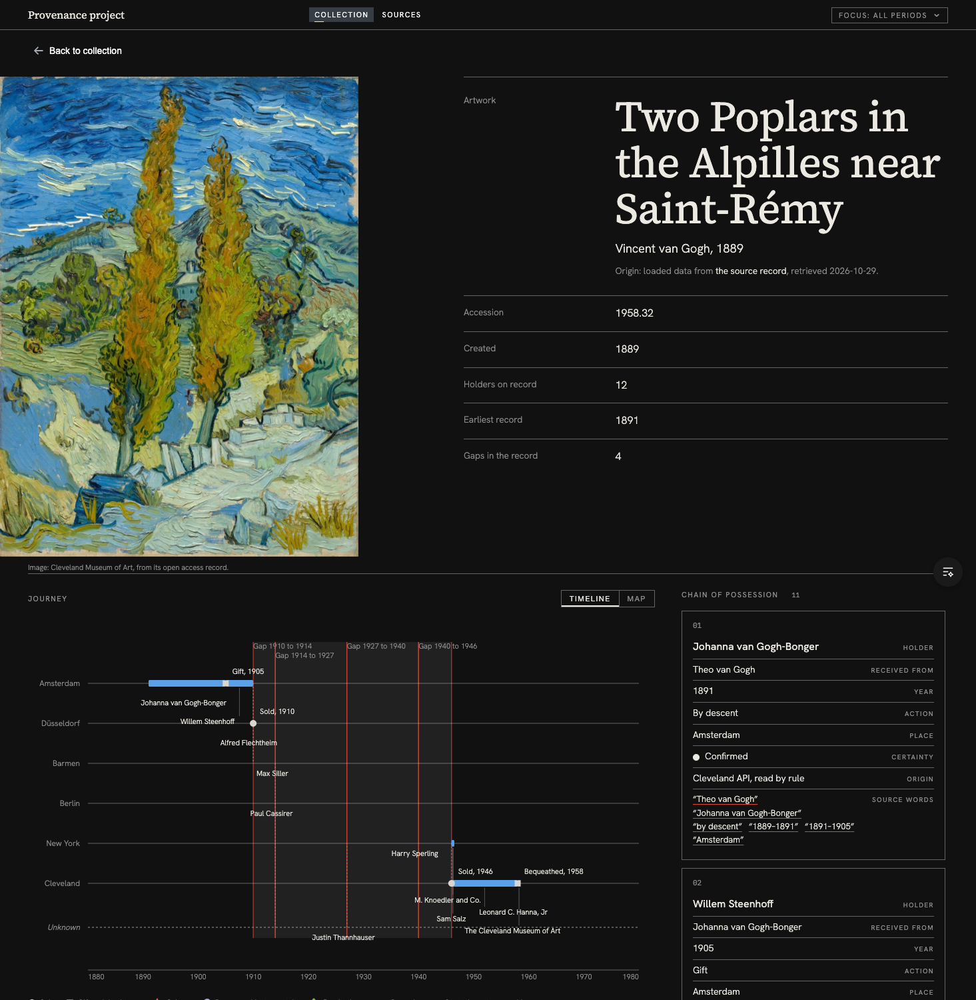
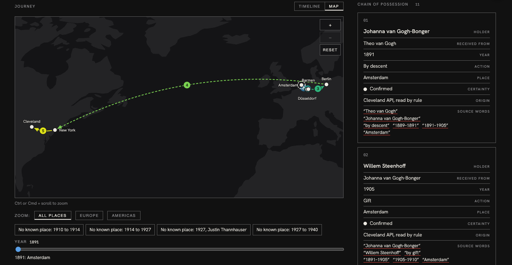

# Moodboard

Open [`moodboard.html`](moodboard.html) for the visual board. This file holds the notes on each reference.

The visual references behind the interface, and what was taken from each. The look is a **dark gallery at night**: the works are the light source, shown as real images on near-black, with museum-label captions, thin rules, one red accent and light type.

The palette and type tokens are in [`design-direction.md`](design-direction.md). Screenshots of this app and the chart reference are in [`moodboard/`](moodboard/). The outside references (01 to 07) are described in words with credits; their images are not included because they are other people's work.

> **Third-party material.** References 01 to 07 are other people's work and are described in words only. Where a reference carries its own credit it is noted below.

## References

### 01 Dark museum app
A museum page in a dark mobile app: charcoal ground, serif titles, a boxed row of three facts (Founded, Paintings, Location), rounded cards, and numbered annotations (01 to 06) ending in small red dots.
- **Taken:** the dark charcoal ground, serif for names, red used only as small dots and links, numbered sections.
- **Changed:** the boxed fact row and rounded cards were flattened into plain rows with hairlines when the direction moved toward 07.

### 02 Objects on black
"Over 8 million objects": cut-out objects floating on black, each with a two-line museum caption, a muted line for the object and a bright line for its place and date.
- **Taken:** the images sit directly on the page ground, with no card behind them, and every collection card has a two-line caption in the same pattern.

### 03 Archive grid
A row of archive objects on dark, with an italic serif title, monospace uppercase headings, small body text, thin rules above each item and one cream button.
- **Taken:** the collection as a grid of images with a rule and a caption beneath each, and monospace uppercase for small labels and numbers.
- **Changed:** the cream button became a charcoal button with white text and a thin white border.

### 04 Black gallery page
A photographer's site: black ground, a serif all-caps statement, a row of overlapping photographs in different sizes, a centred pill button, and a minimal top navigation.
- **Noted for:** the calm, centred composition and the overlap of images of different sizes. Nothing from it is in the interface yet.

### 05 Overlapping translucent images
A grey page with a horizontal band of overlapping translucent images, a thin vertical axis with small labels above and below, an italic-accent serif line and a small "Random / Linear" toggle.
- **Noted for:** layering images in time order along an axis, and the quiet toggle between two arrangements. It resembles the Timeline | Map switch in spirit. Nothing is taken from it directly yet.

### 06 Boxed insets with leader lines
A comet image with boxed close-ups connected to their place on the main image by thin leader lines, each with a small size and date caption. Credit in the image: ESA/Rosetta/NavCam, CC BY-SA IGO 3.0.
- **Noted for:** callouts that point from a detail back to its place on the whole, which is the idea behind the chart's label leader lines and a future gap-detail view.

### 07 Harvard CAMLab
The About page of Harvard's Cognitive Aesthetics Media Lab (camlab.fas.harvard.edu, captured 2026-10-30): near-black ground, a full-bleed cinematic hero, one light-weight sans, and editorial rows with a small label in a narrow left column and a large light headline plus short-line text on the right, separated by full-width hairlines. No cards, no accent colour.
- **Taken:** the row structure used across the app (label column on the left, content on the right, hairlines between), light type at large sizes, a full-bleed artwork image at the top of each artwork page, and flat surfaces. Cards survive in one place only: the source cards.

### 08 Journey chart reference

The project's own reference for the ownership journey: one row per place, solid bars for ownership, an outlined bar for custody, a faded edge for an approximate date, markers by type (sale, gift, seizure, custody, restitution), a dashed line for owner and place unknown, and a shaded 1933 to 1945 band. Rendered from `journey-reference.html` on placeholder data.
- **Taken:** the encodings, the rows by place and the legend.
- **Changed:** owner bars are never drawn across a silence in the record; gaps are bands in their own right; 1933 to 1945 became an optional focus period shown as a thin bracket; labels are placed to avoid collisions.

## Where it landed

### 09 Collection

### 10 Artwork and journey

### 11 Journey as a map

## How the direction moved

1. **Swiss and light.** The first direction was a warm paper ground with a red accent. It was replaced once the references above arrived.
2. **Dark gallery.** References 01 to 03: charcoal ground, serif names, mono labels, one red accent.
3. **CAMLab structure.** Reference 07: flat editorial rows, light type, full-bleed image, no cards.

The reasoning and the final tokens are in [`design-direction.md`](design-direction.md).
